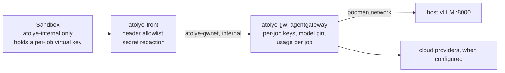

# Model gateway: front filter + agentgateway v1.6.0, and what T2 found

## Topology

**Networks:**
- `atolye-internal` (`--internal`, no egress) carries the sandboxes and the front filter. A sandbox cannot reach
  `atolye-gw` directly: checked, it gets no answer.
- `atolye-gwnet` (`--internal`) carries only the front filter and the gateway.
- The gateway is also on `podman`, to reach the host's vLLM.

**The front filter** (`stack/front/front_filter.py`, stdlib Python, ~140 lines):
- It forwards only allowlisted methods, paths and request headers (`authorization`, `content-type`, `accept`).
- It returns only allowlisted response headers (`content-type`, `retry-after`).
- It redacts configured secrets (`runs/gw/redact.txt`, raw and JSON-escaped) in response bodies. Redaction is
  streaming-safe: `tests/test_front_filter.py` splits a secret at every chunk boundary.

**agentgateway** (`stack/gateway/config.yaml`):
- per-job virtual keys (`atolye.gateway.job_key`, added and removed in file storage mode);
- the model pinned per route;
- a denylist of known steering headers, kept as defence in depth;
- a JSON access log with job id and cache fields;
- the admin and stats listeners on the container's loopback (`statsAddr`).

**Cloud routes** (`stack/gateway/cloud-*.yaml`, `atolye.gateway.CLOUD_ROUTES`):
- A route is rendered into the live config only while its key file exists in `$ATOLYE_SECRETS` (default
  `/home/mega/atolye-acceptance/secrets`, private).
- That directory is mounted read-only into the gateway at `/secrets`. agentgateway reads the key from the file
  (`auth.key.value.file`), so the key is never in the rendered config.
- `gateway.up()` copies every active key to the front filter's redaction list. Deleting the key file and running
  `restart` removes both the route and the redaction entry.
- `gw_quota_errors` counts 401/402/403/429 per job. `atolye-campaign` stops at the first one: a provider refusal is
  never retried in a loop.
- Today: `deepseek-v4.1-flash` on Ollama Cloud (`https://ollama.com/v1`), for T3.

## T2 results (2026-10-26, `bench/t2/run_checks.py`)

| # | Check | agentgateway alone (`T2_DIRECT_GW=1`) | front filter + agentgateway |
|---|---|---|---|
| 1 | `cache_control` survives | pass | pass |
| 2 | Usage counted per job (cache fields, streamed call) | pass | pass |
| 3 | No inbound header forwarding; provider key never reaches the client | **fail**: an unknown header (`x-evil`) is forwarded; an echoed provider key reaches the client | **pass**: no client header forwarded; the echoed key is redacted |
| 4 | Upstream redirect not followed; sandbox has no egress | pass (the `302` and its `Location` reach the client) | pass (the `302` reaches the client without `Location`) |
| 5 | Model pinned; others refused | pass | pass |
| 6 | Per-job key accepted / revoked quickly | pass (0.31 s / 0.31 s) | pass (0.41 s / 0.31 s) |
| 7 | Overhead at 8 concurrent requests | pass | pass (median 2.82 s vs 2.80 s direct) |
| 8 | Runs on arm64 | pass | pass |
| 9 | Malformed requests refused (path variants, absolute-form target, query, encoded `..`, `Content-Length: -1`) | n/a | pass (all 404/400), added after the independent review |

**After the independent review (PR #4):**
- The filter matches paths exactly and forwards only the checked path.
- It refuses bad framing, drops the upstream request when the client disconnects, and re-reads the secrets file
  when it changes.
- `up()` restarts stopped containers and probes through the filter.
- Job keys carry an expiry, and usage is read until it settles.
- Replies the gateway makes itself (its own 400/403/404) carry no job id, so `gw_errors` does not count them.

## Upstream contributions: assessment (operator rule: contribute only what is generally meaningful)

agentgateway's Code of Conduct has a **Generative AI policy**: "Refrain from generating issues, comments, or PR
descriptions with AI", and no agents scanning the tracker
(https://github.com/agentgateway/agentgateway/blob/main/CODE_OF_CONDUCT.md). So this repository does **not** open
issues there. A human writes them, if at all.

| Gap | Generally meaningful upstream? | What we do |
|---|---|---|
| No inbound-header **allowlist** on LLM routes (`requestHeaders` supports only `add`/`set`/`remove`) | **Probably yes.** Any multi-tenant gateway wants to stop clients from steering providers with headers it does not know. A related closed issue went the other way (#1777, "Don't strip beta headers from anthropic requests"), so maintainers may want it opt-in | Our front filter. A human may propose an opt-in allowlist mode, citing check 3 |
| No **redaction** of a backend credential echoed by an upstream | **No.** It defends against a hostile or buggy provider in our sandbox threat model; a general gateway trusts its configured providers | Our front filter only |
| Stats listener on all interfaces by default | **No.** `config.statsAddr` exists; configuration was enough | Configured |
